# enablestack

[](LICENSE)

**A business-first SDLC conductor for agentic software work.**

enablestack helps an owner turn an idea into accepted, merged work without losing the intent between discovery, design, implementation, and validation.
The enablement idea is simple: leadership is not about doing every job yourself, but about building a system in which people and tools can do their best work with clear decisions, evidence, and ownership.

This repository contains `impact-work-sdlc`, an agent skill that coordinates specialist skills rather than replacing them.
It adds the shared thread they need: an approved business brief, explicit owner gates, model routing, security checks, browser UAT, and durable park-and-resume state.

## The process

The business brief is the source of truth throughout the run.
Nothing technical starts before Gate 0, nothing is built before the design and plan gates, and acceptance is based on the same scenarios approved at the beginning.

```mermaid
flowchart TB
    subgraph Business["1. Business first"]
        Enter["0 · Enter<br/>Preflight and resume check"] --> Size["1 · Size<br/>Quick, small, or project"]
        Size --> Discover["2 · Discover<br/>Open questions"]
        Discover --> Grill["3 · Business grill<br/>Needs, people, success"]
        Grill --> Brief["Business brief<br/>Requirements, criteria, scenarios"]
        Brief --> G0{{"Gate 0 · Approve the brief"}}
        Brief -. optional .-> Prototype["Prototype and walkthrough"]
        Prototype -. feedback .-> G0
    end

    subgraph Design["2. Technical design"]
        G0 -. one-way decisions .-> Arena["4A · Design Arena<br/>Conditional"]
        G0 --> Approach["4 · Approaches"]
        Arena --> Approach
        Approach --> Sections["5 · Design sections<br/>Technical grill"]
        Sections --> Written["6 · Written design<br/>Builder check"]
        Written -. when risk warrants .-> Critique["6A · Critique Arena"]
        Written --> GA{{"Gate A · Design matches brief"}}
        Critique --> GA
    end

    subgraph Delivery["3. Build and accept"]
        GA --> Plan["7 · Plan<br/>Units trace to scenarios"]
        Plan --> GB{{"Gate B · Approve plan, cost, installs"}}
        GB --> Build["8 · Build<br/>Fast checks per commit"]
        Build --> Security["Pre-check-in gate<br/>Secrets, dependencies, static analysis,<br/>licenses, lint, tests, build"]
        Security --> Review["Independent review<br/>Different model, T2+"]
        Review --> UAT["8U · Browser UAT<br/>Approved scenarios on desktop and phone"]
        UAT --> Accept{{"S16 · Owner acceptance"}}
        Accept --> Merge{{"S8 · Approve merge<br/>Checks rerun on merge result"}}
        Merge --> Close["9 · Close<br/>Audit trail and routing summary"]
        Review -. findings .-> Build
        UAT -. scenario miss .-> Build
    end

    classDef gate fill:#fff1f2,stroke:#be123c,stroke-width:2px,color:#881337;
    classDef artifact fill:#ecfdf5,stroke:#059669,color:#064e3b;
    class G0,GA,GB,Accept,Merge gate;
    class Brief,Close artifact;
```



Conditional Arena phases run only when the decision is consequential and multiple viable shapes remain.
Small runs use a shorter version of the same path and skip Gate B; quick work takes the direct path without a stored run or gates beyond irreversible actions.

### Gates and ownership

| Stage | What happens | Who owns the decision |
|---|---|---|
| Gate 0 | The owner approves business requirements, measurable success criteria, acceptance scenarios, scope, and assumptions. | The project owner; approval starts technical design, not building. |
| Gate A | The written design is checked against every approved requirement and scenario. | The project owner; approval starts planning only. |
| Gate B | The plan shows units, model tiers, cost, installs, scenario coverage, UAT automation, and pre-check-in setup. | The project owner; approval starts the build. |
| Pre-check-in | Deterministic scanners, project checks, and AI security review run before review and again on the merge result. | Tools determine pass or fail; only the owner can approve a time-limited waiver at S17. |
| Independent review | A different T2-or-higher model reviews correctness and security; UI work receives a separate UI review. | Review findings return to the build and cannot silently pass. |
| Browser UAT | Playwright runs the Gate 0 scenarios as a user at desktop and phone sizes and records screenshots, traces, and video. | The approved brief determines what is tested. |
| S16 acceptance | UAT results are presented beside the brief, with failures, flakes, and skipped scenarios first. | The project owner accepts the outcome or names what is not right. |
| S8 merge | The pre-check-in gate reruns on the merge result and the PR, warnings, waivers, reviews, and UAT summary are shown together. | The project owner explicitly approves that merge. |

At every owner stop, `park` is a valid answer.
The skill never treats silence as approval and never performs an outward action such as pushing, publishing, deploying, or messaging without an explicit go.

## What the skill does

`impact-work-sdlc` is a conductor for a complete project lifecycle.
It:

- turns discovery into a business-language brief with measurable acceptance scenarios;
- keeps technical design and implementation behind explicit owner gates;
- delegates planning, building, security review, and independent review to specialist skills;
- routes work by risk and requires a different model for review;
- installs a project-specific pre-check-in gate for secrets, vulnerable dependencies, static analysis, licenses, formatting, tests, and builds;
- runs browser UAT against the original acceptance scenarios;
- records decisions, artifact hashes, checkpoints, routing, evidence, and acceptance; and
- can park safely at any stop and resume from the exact saved state.

### Use it when

- a feature or project should run from a plain-language brief through merge;
- the work has meaningful product, architecture, security, cost, or acceptance decisions;
- several agent skills or models need a shared process and audit trail; or
- you want to pause for stakeholders and resume without reconstructing context.

### Do not use it when

- the task is a quick fix with no meaningful product or architecture decision;
- you only need an investigation or research answer;
- the work is limited to monitoring or babysitting an existing pull request; or
- you want to bypass owner approval for irreversible or outward actions.

## Prerequisites

The repository provides the conductor skill.
Its required owners must also be installed because the conductor intentionally does not reproduce their behavior.

### Required

| Dependency | Purpose | Install |
|---|---|---|
| Python 3 | Runs lifecycle state and pre-check-in scripts. | macOS: `brew install python` |
| Superpowers brainstorming | Discovery, sizing, approaches, and the design gate. | `claude plugin install superpowers@claude-plugins-official` |
| `grill-me` | One-question-at-a-time business and technical grilling. | `npx skills add mattpocock/skills --skill grill-me` |
| PStack | Planning, build playbooks, Arena, reviews, verification, and the audit trail. | `claude plugin marketplace add michael-denyer/pstack-claude && claude plugin install pstack@pstack-claude` |

Run the packaged preflight after installation:

```bash
~/.claude/skills/impact-work-sdlc/scripts/preflight.sh
```

Add `--ui` when the project includes user interface work.
Preflight prints the detected owner versions, missing install commands, and optional tool status.

### Recommended for the full security gate

Missing scanners are reported as **not run**, never as a pass.
A required blocking check that cannot run needs an explicit S17 waiver before merge.

```bash
brew install gitleaks osv-scanner semgrep
```

### Conditional and optional

| Dependency | When it is used | Install or behavior when absent |
|---|---|---|
| Node.js and Playwright | Browser UAT for applications with browser scenarios. | `brew install node`, then in the target project run `npm install -D @playwright/test && npx playwright install chromium`. |
| Impeccable | Required for UI runs: product context, visual direction, craft checks, and UI review. | `npx skills add pbakaus/impeccable`; non-UI runs do not need it. |
| `lavish-axi` | Local review boards at owner stops. | Optional; the skill falls back to a Markdown document and one chat question. |
| `ffmpeg` and macOS `say` | Optional narrated prototype walkthroughs. | `brew install ffmpeg`; if either tool is unavailable, narration is skipped. |
| `tech-stack-eval` and `domain-modeling` | New-project stack evaluation and ADRs. | Optional; stack evaluation has a built-in rubric and records when the specialist is absent. |
| WebKit for Playwright | Only when the brief names Safari or iPhone users. | `npx playwright install webkit`. |

## Installation

### Claude Code

Clone the repository to a stable location:

```bash
git clone https://github.com/umakesan/enablestack.git ~/.local/share/enablestack
mkdir -p ~/.claude/skills
```

Then choose one installation method.

Copy the skill for an independent installation:

```bash
cp -R ~/.local/share/enablestack/skills/impact-work-sdlc ~/.claude/skills/
```

Or symlink it so a `git pull` updates the installed skill:

```bash
ln -s ~/.local/share/enablestack/skills/impact-work-sdlc ~/.claude/skills/impact-work-sdlc
```

Do not use both methods at the same destination.

### Codex and other agents

Codex can discover the skill from its standard skill directory:

```bash
mkdir -p ~/.codex/skills
ln -s ~/.local/share/enablestack/skills/impact-work-sdlc ~/.codex/skills/impact-work-sdlc
```

Other skill-aware agents can copy or symlink the same folder into their own skill directory.
The skill includes runtime-specific owner names in `references/handoffs.md`; PStack-owned phases can run through Claude workers when those capabilities are not installed natively in the conductor runtime.

## Quick start

In a project directory, invoke the skill with a plain-language goal:

```text
/impact-work-sdlc Build a self-service way for members to update their notification preferences.
```

You can also say “run the SDLC” or “start a new project the full way.”

The skill first runs preflight, checks for a resumable run, and states the inferred size and whether the work includes UI.
For a small or project-size run, it then asks open discovery questions one at a time, conducts the business grill, and writes a brief containing:

- requirements in business language;
- measurable success criteria;
- Given/When/Then acceptance scenarios;
- out-of-scope items; and
- open decisions and delegated assumptions.

The first hard stop is Gate 0.
You review the brief and either approve it, request a change, ask for an optional prototype, or park the run.
Approval starts technical design only.

## Park and resume

Say `park` at any owner stop, or at any time.
The skill completes or backs out of the current atomic step, checkpoints the run, saves in-progress state, stops local review boards, and reports the exact resume point.

To continue in the same project later:

```text
/impact-work-sdlc resume
```

Resume verifies approved artifact hashes, interrupted work, dependency versions, and movement of the default branch before continuing.
It does not reconstruct missing state from memory or repeat already approved questions.

By default, run state is stored under `~/.claude/orchestrate/<project-slug>/` and a short checkpoint lives at `docs/sdlc/checkpoint.md` in the project.
Set `SDLC_STORE_ROOT` to choose another private store location.

## Repository layout

```text
enablestack/
├── README.md
├── LICENSE
└── skills/
    └── impact-work-sdlc/
        ├── SKILL.md              # Conductor contract and phase map
        ├── agents/openai.yaml    # Agent-facing metadata
        ├── assets/               # Brief, board, checkpoint, UAT, and gate templates
        ├── references/           # Phase-specific operating rules
        └── scripts/              # Preflight, lifecycle state, and pre-check-in runner
```

The skill reads references only when their phase begins.
Templates are copied into a run and are never edited in place.

## Contributing

Issues and pull requests are welcome.
Keep changes focused on the conductor and its contracts, preserve the existing `skills/impact-work-sdlc` folder name, and update the relevant reference instead of duplicating a rule in multiple places.

Before opening a pull request, run:

```bash
bash -n skills/impact-work-sdlc/scripts/preflight.sh
python3 -m py_compile \
  skills/impact-work-sdlc/scripts/precheckin.py \
  skills/impact-work-sdlc/scripts/sdlc_state.py
skills/impact-work-sdlc/scripts/preflight.sh --versions
```

Please describe the behavior changed, the validation performed, and any dependency or gate implications in the pull request.

## License

enablestack is available under the [MIT License](LICENSE).
